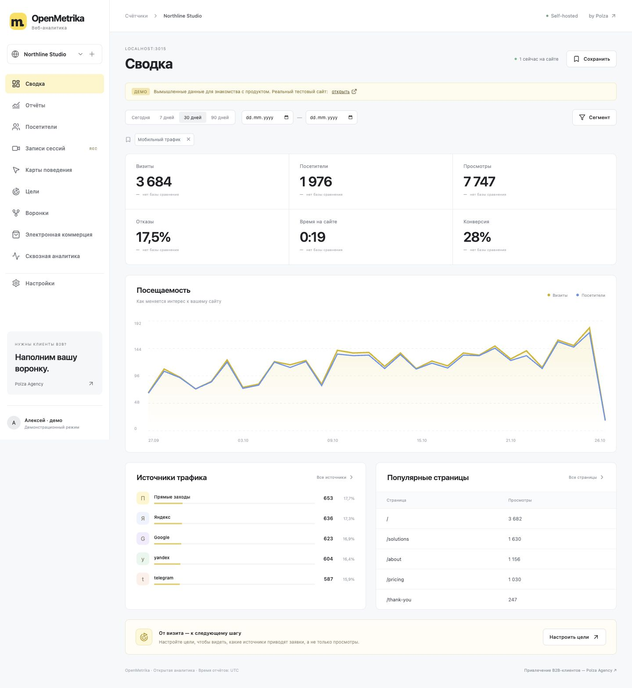

# OpenMetrika

Открытая веб-аналитика для самостоятельного размещения: трафик, цели, воронки,
записи сессий, карты поведения и ecommerce. Интерфейс и код собственные,
проект не связан с Яндексом. Лицензия MIT.

Проект [Polza Agency](https://polzaagency.ru/?utm_source=openmetrika&utm_medium=github).
Если нужны B2B-клиенты, поможем наполнить воронку: целевые компании, аутрич,
квалификация ответов и встречи.



## Быстрый запуск

Нужен **Node.js 24+**.

```sh
npm ci
npm run build
npm start
```

Откройте http://127.0.0.1:3015, создайте администратора и добавьте счётчик.
В настройках укажите разрешённые домены и скопируйте код на свой сайт.
База SQLite хранится в `data/openmetrika.db` и не попадает в Git.

```sh
# Отдельное демо с вымышленными данными и временной базой
npm run demo
# Разработка: интерфейс :5180, сервер :3015
npm run dev
# Docker
docker compose up --build -d
```

Демо и обычный сервер используют один порт — запускайте их по очереди.
В демо есть тестовый сайт `/fixture/`: перейдите по страницам, отправьте
тестовую форму и посмотрите реальные события в аналитике. Ввод полей маскируется,
блок с `om-block` скрывается. Формы тестового сайта не отправляют письма и заявки.

## Возможности

- Счётчики разных сайтов, сотрудники с правами просмотра/редактирования,
  владелец, вход по паролю и отдельные ключи API для чтения.
- Просмотры, SPA-переходы, UTM, события, цели, клики, глубина скролла,
  внешние ссылки, скачивания, формы и активное время.
- Сводка с динамикой и сравнением периодов. Источники, кампании, страницы,
  входы/выходы, устройства, браузеры, ОС, события, скорость и ошибки.
- Даты, сегменты, сохранённые отчёты, сортировка таблиц и CSV.
- Цели по событию или странице, конверсии, последовательные воронки.
- Запись визитов на rrweb с плеером, перемоткой и маскированием ввода.
- Карта кликов поверх сохранённого DOM-снимка, сетка координат, ссылки, скроллинг и формы.
- Покупки и товары, выручка отдельно по каждой валюте, импорт расходов из CSV,
  расчёт ROAS по источнику/кампании.
- Резервные копии с контрольной суммой и проверкой восстановления,
  автоматическое удаление старых визитов/записей.

## Публикация на своём сервере

Compose слушает только `127.0.0.1:3015`. Для доступа извне настройте HTTPS
reverse proxy, `COOKIE_SECURE=1` и `PUBLIC_ORIGIN=https://ваш-домен`.
Первого администратора создавайте до открытия публичного доступа.
`DEMO_MODE=1` автоматически даёт доступ к демо — не включайте его публично
без `DEMO_READ_ONLY=1` и контроля доступа.

Сервер по умолчанию хранит визиты 180 дней, записи — 30 дней.
Параметры: `RETENTION_DAYS`, `REPLAY_RETENTION_DAYS`.

## Резервная копия

```sh
npm run backup -- create ./backups/snapshot
npm run backup -- verify ./backups/snapshot
# Остановите приложение, сохраните текущую базу с -wal/-shm отдельно:
npm run backup -- restore ./backups/snapshot
```

Копия согласованная даже при работающей SQLite. Восстановление не перезаписывает
существующие данные. Храните копии отдельно от сервера.

## Что важно понимать

Это самостоятельная аналитика, а не доступ к закрытым данным Яндекса.
Пол, возраст, интересы, скрытые поисковые запросы и данные Директа из браузерного
счётчика не появляются. География без GeoIP остаётся неизвестной.
Расходы вводятся/импортируются, доходы поступают из ecommerce; CRM-коннектора пока нет.
Карта кликов накладывается на сохранённый DOM-снимок страницы; без подходящей записи доступна сетка нормализованных координат.
Запись iframe с другого домена, canvas, видео и недоступных ресурсов ограничена.

Даты отчётов — UTC. Отказ: меньше двух просмотров, меньше 15 активных секунд,
нет цели. Конверсия — доля визитов с целью. Формы считают события submit,
а подтверждённую заявку нужно передавать отдельным событием после успеха сервера.
Данные каждого отчёта и ограничения выборок описаны в [английском README](README.md).

Проверки: `npm test`, `npm run build`, `npm audit --omit=dev`.

[Счётчик и API](docs/INTEGRATION.md) · [Безопасность](SECURITY.md) · [Участие](CONTRIBUTING.md)
