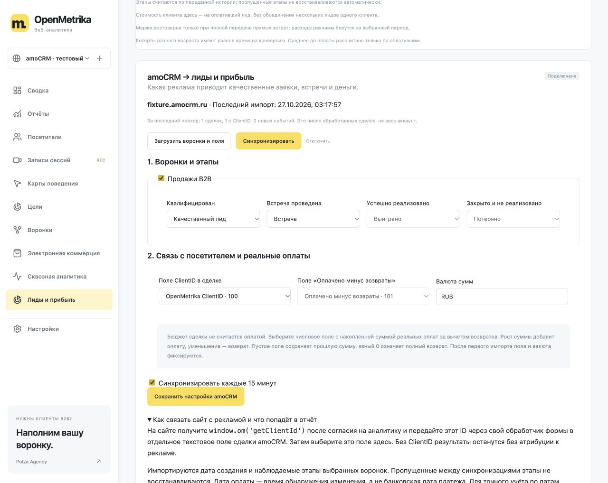

# amoCRM → OpenMetrika

Нативный OAuth-коннектор импортирует сделки в отчёт **«Лиды и прибыль»**.
Он читает amoCRM и не изменяет сделки, контакты или настройки аккаунта.
Поддерживается российская платформа `*.amocrm.ru`. Kommo не подключается этим коннектором.



## Подготовка сервера

1. Нужна собственная установка OpenMetrika на HTTPS-домене, вход в неё под владельцем
   счётчика и права администратора amoCRM. В публичном демо OAuth отключён.
2. Создайте интеграцию в amoМаркет по
   [официальной инструкции OAuth](https://www.amocrm.ru/developers/content/oauth/step-by-step).
   Redirect URI должен быть в точности `https://ВАШ-ДОМЕН/api/amocrm/callback`.
   Это интеграция без виджета; авторизация начинается кнопкой из OpenMetrika.
   Выбирайте минимальные доступные разрешения для чтения сделок и их полей.
   **Перед созданием приватной интеграции прочитайте условия amoCRM:** в официальной
   инструкции описано необратимое соглашение об отказе от технической поддержки
   на нетехническом аккаунте. OpenMetrika не создаёт приложение и не принимает это
   соглашение автоматически. Для публичной интеграции действуют требования amoМаркет.
3. Скопируйте `.env.example` в `.env`, заполните **на сервере**, без коммита в Git:

   ```dotenv
   PUBLIC_ORIGIN=https://analytics.example.com
   COOKIE_SECURE=1
   AMO_CLIENT_ID=ID_ПРИЛОЖЕНИЯ
   AMO_CLIENT_SECRET=СЕКРЕТ_ПРИЛОЖЕНИЯ
   AMO_REDIRECT_URI=https://analytics.example.com/api/amocrm/callback
   AMO_TOKEN_ENCRYPTION_KEY=64_HEX_СИМВОЛА
   ```

   Ключ шифрования сгенерируйте один раз:

   ```sh
   node -e "console.log(require('node:crypto').randomBytes(32).toString('hex'))"
   chmod 600 .env
   ```

   Храните резервную копию ключа **отдельно и безопасно**. После перезапуска ключ
   должен остаться прежним. Без него сохранённые OAuth-токены не расшифровать;
   потребуется повторное разрешение доступа. Штатная копия SQLite включает
   зашифрованные токены, но не включает `.env` и ключ шифрования.
4. Перезапустите Node-процесс (`npm start` читает `.env`) или пересоздайте контейнер
   (`docker compose up --build -d`; Compose передаёт переменные в контейнер).
   Не публикуйте вывод `docker compose config`, inspect или `.env`: там секреты.

## Подключение в интерфейсе

1. Откройте нужный счётчик → **Лиды и прибыль → amoCRM**.
2. Введите адрес `company.amocrm.ru`, нажмите **«Подключить через amoCRM»**.
   В окне amoCRM проверьте приложение и аккаунт, затем самостоятельно разрешите
   доступ. Возврат должен происходить в тот же браузер с активной сессией владельца.
   Если сессия истекла, войдите в OpenMetrika и начните подключение заново.
3. Загрузите воронки и поля. Выберите нужные воронки, сопоставьте этапы с
   квалификацией, встречей, выигрышем или потерей. Системные `142/143` — выиграно/потеряно.
   Все сделки выбранных воронок создают заявку, в том числе ещё без сопоставленного этапа.
4. Выберите текстовое поле ClientID, при необходимости поле оплат и валюту его сумм.
   Сохраните настройки, нажмите **«Синхронизировать»**.
5. Автосинхронизация запускается работающим сервером каждые 15 минут.
   Кнопка запускает импорт в фоне, прогресс/ошибка доступны владельцу.
   После завершения бизнес-отчёт обновится автоматически.
   Выключение автосинхронизации оставляет ручной импорт.

Выбор воронок влияет на последующие импорты: уже импортированные результаты
не исчезают при снятии галочки воронки. Для другого аккаунта amoCRM используйте отдельный счётчик. Отключение удаляет токены,
но сохраняет настройки и импортированную историю, чтобы повторное подключение не
дублировало оплаты. Отозвать доступ у провайдера можно также в amoCRM.

## ClientID: атрибуция к рекламе

Создайте в **сделке** amoCRM отдельное текстовое поле `OpenMetrika ClientID`.
При отправке формы после разрешения аналитики получите ID:

```js
const clientId = window.om?.('getClientId') // строка либо null без согласия
```

Передайте его в свой серверный обработчик формы. Уже ваш обработчик, создающий
сделку, записывает значение в выбранное дополнительное поле amoCRM. OAuth-секреты
и токены в HTML/JS сайта не вставляются. Сам коннектор не меняет обработчики форм
и не создаёт сделки. Телефон и email для склейки не используются.

Без ClientID сделка импортируется как неатрибутированная. Пустой ClientID можно
заполнить позднее; уже закреплённый ID перепривязать нельзя. Некорректный формат
ID остаётся без привязки. Чтобы видеть канал, соответствующий визит должен быть
в базе счётчика и попадать в выбранное окно атрибуции. Число «с ClientID» показывает
наличие допустимого ID, а не гарантированное наличие подходящего визита.

## Оплаты, возвраты и ограничения истории

- **Бюджет/price и «успешно реализовано» не считаются выручкой.** Без выбранного поля
  реальных оплат коннектор импортирует только этапы, с нулевой выручкой.
- Поле оплат должно содержать **накопленную сумму полученных денег за вычетом возвратов
  по одной сделке**, в заданной валюте. Например, `0 → 10000 → 15000 → 12000` даёт
  оплаты `10000`, `5000` и возврат `3000`. Точность — до двух знаков после точки.
- Пустое/удалённое значение не обнуляет оплату. Явный `0` после оплаты означает полный
  возврат. Исправление суммы также создаёт корректировку; данные поля должны вести
  сотрудники, отвечающие за оплаты. Отрицательные суммы и возврат сверх полученной
  суммы этой моделью не поддерживаются. Сделки с разными валютами разделяйте по счётчикам.
- После первого импорта (в том числе частичного) поле оплат и валюту менять нельзя.
  Прямые затраты, себестоимость и банковские даты платежей коннектор не импортирует;
  передавайте их через [API событий продаж](BUSINESS.md).
- Первая загрузка видит дату создания и **текущий** этап сделки. Между опросами
  промежуточные этапы могут быть пропущены. Пропущенные встречи/квалификация не
  придумываются. Сопоставленные этапы фиксируются при первом обнаружении.
- Даты новых этапов и оплат — время обнаружения коннектором, не доказанная дата
  перехода или банковская дата. Первая загрузка старых сделок может увеличить
  «дней до оплаты». Для точной исторической/финансовой аналитики импортируйте
  исходные события с реальными датами через API, избегая дублей с коннектором.
- Повторный запуск не удваивает выручку. Переоткрытие, потеря или удаление сделки
  сами по себе не означают возврат. Удаление лида из OpenMetrika не удаляет его из
  amoCRM: при следующем импорте он может появиться снова. Для окончательного
  удаления сначала исключите источник из синхронизации.

## Надёжность и безопасность

Одноразовый OAuth state действует 10 минут и привязан к владельцу, счётчику и
заранее указанному аккаунту. Токены зашифрованы AES-256-GCM, связаны со счётчиком,
не возвращаются браузеру. Refresh-токен автоматически обновляется и сохраняется;
параллельные операции одного подключения блокируются, чтобы одноразовый refresh
не использовался дважды.

Запросы идут только на проверенные HTTPS-хосты amoCRM; перенаправления запрещены.
Страницы коннектор строит самостоятельно: ссылки из ответа API не открываются.
На аккаунт выдерживается пауза 220 мс между запросами в одном процессе;
429 повторяется до двух раз с ограниченным ожиданием, сетевой таймаут 15 секунд.
Ответы провайдера не включаются в сообщения об ошибках. Имена сделок, контакты,
телефоны/email не сохраняются; через сеть они могут приходить в стандартном
ответе списка сделок, который используется только в оперативной памяти.

Первый проход постранично читает сделки, последующие идут по `updated_at DESC` и
останавливаются на водоразделе последнего успешного прохода с перекрытием 120 секунд.
Отдельный платный API-фильтр amoCRM не требуется. Лимит одного прохода — 250 000
сделок. Время сервера должно быть синхронизировано. При сбое курсор не двигается,
успешные сделки сохраняются, повтор безопасен. События и контрольная запись
каждой сделки фиксируются одной транзакцией SQLite. Подключение рассчитано на
один Node-процесс на базу (не несколько кластерных воркеров).

Методы `/api/sites/:siteId/amocrm`, `/connect`, `/catalog`, `/sync` доступны только
владельцу через обычную сессию. Read-only ключи отчётов и ключи общего импорта CRM
к ним доступа не имеют. Демо запрещает подключение; режим read-only запрещает OAuth
и синхронизацию. Webhook-порт наружу не открывается.

Официальные контракты: [OAuth](https://www.amocrm.ru/developers/content/oauth/step-by-step),
[сделки](https://www.amocrm.ru/developers/content/crm_platform/leads-api),
[воронки](https://www.amocrm.ru/developers/content/crm_platform/leads_pipelines),
[дополнительные поля](https://www.amocrm.ru/developers/content/crm_platform/custom-fields).
